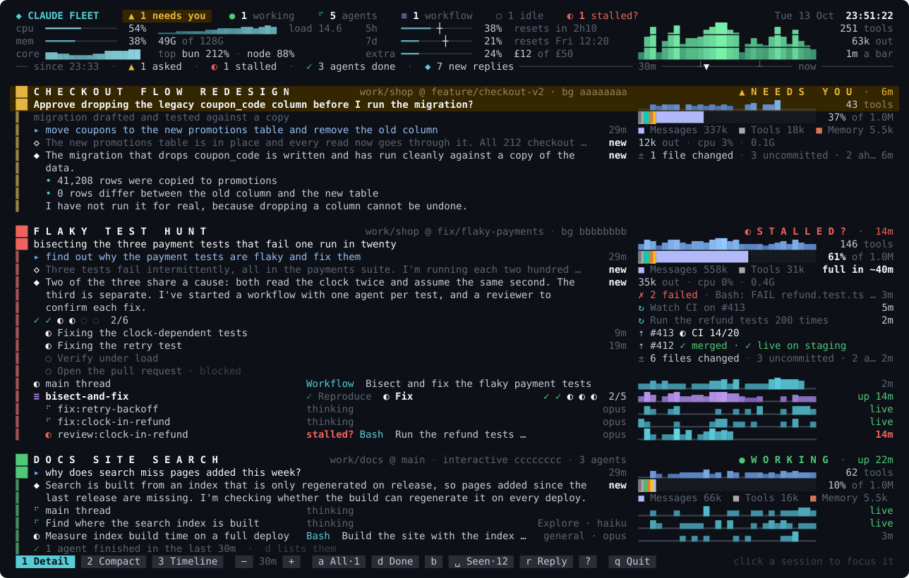
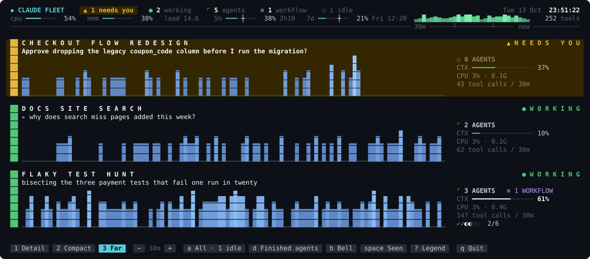

# Claude Fleet

Every live Claude Code session on one terminal screen: what each one is doing, which ones are waiting on you, and what their agents, workflows and tasks are up to.



It is one TypeScript file with no dependencies. It reads the files Claude Code already keeps under `~/.claude`. The only thing it ever writes is one small file of usage figures, and only with `--usage` (see [Account usage and your login](#account-usage-and-your-login)).

## Try it

```bash
git clone https://github.com/pdaddyo/claude-fleet
cd claude-fleet
bun demo.ts        # made-up sessions, so you can see everything straight away
bun fleet.ts       # your real sessions
```

You need [Bun](https://bun.sh) and a terminal with 24-bit colour. The screen is laid out for anything from 80 columns by 24 rows up. At 150 by 44 three busy sessions show in full; a smaller pane gives things up in a fixed order (see below) instead of losing whatever happens to be at the bottom.

To run it from anywhere, add an alias to your shell profile:

```bash
alias fleet='bun ~/path/to/claude-fleet/fleet.ts --usage'
```

## What is on the screen

**At the top**

- **Counts:** how many sessions need you (the one amber thing on the row), how many are working, running agents and workflows, and how many idle or finished sessions are being kept off the screen. A red `◐ 1 stalled?` joins them while something looks stuck.
- **The machine:** CPU with a short history, memory, one glyph per core, load, and the busiest processes.
- **Your account** (with `--usage`): how much of the 5-hour and weekly limits you have used and when each resets, then extra usage. With extra usage off, that row shows the Opus and Sonnet weekly limits when Anthropic returns them. Without `--usage` this block lists the busiest processes instead.
- **The fleet:** tool calls across the window as a chart, with the total, the output tokens and how long one bar is.
- **The rule under it is the time axis** for every sparkline below: each sits in the same columns and counts the same bars, and the header's total is the sum of the sessions' own.

The header is five rows on a terminal of 40 rows or more and three rows below that, with one more while the usage read fails for a reason you can do something about (see [In a remote session](#in-a-remote-session-ssh-or-mosh)). Compact mode, and any terminal under 100 columns, keeps a plainer header: one line for the fleet, one for the machine, one for the account.

**For each session** (detail mode)

- **Two head rows:** a rail in the colour of the session's state, its name, its folder and branch, and the state with how long it has been so: `▲ NEEDS YOU`, `◐ STALLED?`, `● WORKING`, `▸ YOUR TURN`, `○ IDLE` or `✓ FINISHED`. Under that, one line saying what it is doing, a sparkline of its tool calls and their count. When the session needs you the line is the question itself, on up to three rows of an amber band (all of it when you focus the session); those sessions sort to the top.
- **Conversation:** `▸` your prompt, `◇` Claude's earlier replies (dimmed) and `◆` its newest reply with its bullets, code and tables kept, each with its age in a column of its own. A long reply is cut in the middle, never at the end: its closing paragraph stays (up to three rows of it) and `… +5 lines` says how much is hidden.
- **Beside the conversation:** the context window split by category (system prompt, tools, MCP tools, agents, memory files, skills, messages), then output tokens and the CPU and memory of the session's processes. Below 130 columns these become one row under the head.
- **Tasks:** one glyph per task (`✓` done, `◐` in progress, `○` not started) and how many are done, then the open tasks listed one a row under it, indented: those in progress first (`◐`, what each is doing), then the ones still to start (`○`, dimmed, `· blocked` after any that wait on an unfinished task). Done tasks are counted, not listed. The task in progress has a row of its own in the list; it is named after the count instead when the list has no row for it: when it is the only open task, when the line under the title already names it, or once the list is cut away. When rows run short the list shortens in stages, to five rows, then three, ending `… 5 more tasks`, then only the tasks in progress (none, when there is one), then none. Focus a session to list every task in full, done ones included.

  While there is room, each listed task gets one more line under it. A task in progress shows how long it has been running, and under it the latest thing Claude wrote while it was the task in hand (`◇`, with its age), unless that message is already one of the replies shown above. Otherwise, and for tasks still to start, the line says what the task is for, from its description. A message counts towards the task started most recently of those in progress when it was written; `fleet` learns this from each task's start and finish in the session's transcript, searching the whole file once so that tasks started long ago are known too. These lines are the first thing to go when rows run short. In focus, done tasks get theirs too, and a long one takes up to three rows.
- **Threads:** the main thread, each workflow (`≡`, the phases it has been through in order, a phase it comes back to listed again, with a `…` in front when the earliest do not fit; then one glyph per agent) and each agent: a spinner if it wrote in the last minute, `◐` with the tool and what it is for if it is waiting on one, `○` if it is quiet.

When the screen is too short for all of that, sessions give rows up in a fixed order, from the bottom session upward: the lines under each task (first what each task not yet started is for, then the latest message under those in progress), earlier replies, each task list down to five rows, the finished-agents line, each task list down to three, most of each newest reply, the blank rows between sessions, prompts, the tasks still to start, main-thread rows, then per-agent rows. A session that needs you always keeps its question (up to three rows) and two lines of the reply. Sessions that still do not fit become one line, `… 2 more: name, name`. Rows left over are handed back in the reverse order, top session first.

Only sessions that are working or waiting on you are shown. Idle and finished ones are counted on the top row and on the `a` button (`a All · 1 idle`); press `a` to bring them back (in detail mode, as two rows each).

## The marks

The screen uses one small set of marks, the same in all three modes, and no word labels. Press `?` for this list on the screen itself.

| Mark | Means |
| --- | --- |
| `▲` | Needs you: the session is blocked on your answer. The only "look here" mark, and the only amber on the screen. |
| `●` | Working: a session that is alive and busy. |
| `▸` | You: something you typed, or a session whose turn is yours. |
| `◆` | Claude: the name at the top left, and Claude's newest reply. Bold white while that reply is new since you last looked. |
| `◇` | An earlier reply. |
| `⠋` | Live: wrote within the last minute. It spins. |
| `◐` | In progress: a task under way, a workflow's current phase, a thread with a tool call outstanding. Red when it looks stalled. |
| `○` | Not started, quiet or idle. |
| `✓` `✗` | Done; failed, stopped or unavailable. |
| `≡` | Workflow. Purple means workflow and nothing else. |
| `██` `▌` | The rail down the left of a session, in the colour of its state: thick on the two head rows, thin below. |
| `▁▃▅█` | Activity over time. One cell is one bar of the window, oldest on the left; the rightmost bar is still filling. |
| `━` `─` `╌` | A gauge: used, remaining, no reading. Calm below 60%, bold white from 60%, red from 80%. CPU is a rate, not a limit, and never turns warm. |
| `┼` `┿` | The pace tick on a usage gauge: how far through that limit's window the clock is. |
| `█` `▌` `░` `■` | The context window, filled by category; `░` is free space and `■` the colour key. |
| `┴` `▼` | On the time axis: each third of the window, and when you last pressed `space`. |
| `…` | Something was cut: `… +5 lines`, `… 2 more agents`. |

One rule for colour: warm means you. Amber is spent only where you are needed and red only where something is broken, stalled or nearly out. Everything else is cool or grey.

`bun fleet.ts --glyphs` prints a test card of every glyph, each between two bars, so you can check that your terminal (an iPad over mosh, say) draws each one a single cell wide. If one is out of line, `--plain-glyphs` swaps in fallbacks for the four that fonts most often lack: `≡` becomes `◇`, `┿` becomes `┼`, `╌` becomes `─` and `◇` becomes `◆`.

## View modes

| Key | Mode | For |
| --- | --- | --- |
| `1` | Detail | Sitting at the screen. Everything above. |
| `2` | Compact | Many sessions. One line per session and per agent, under the plainer header. |
| `3` | Far | A spare monitor across the room. Big cards where colour and shape carry the state. |



Click a session, or press `tab`, to focus on it alone; it then gets the whole screen, with its whole question, every reply it still holds in full and every agent. `tab` again moves to the next session and `esc` goes back.

## Controls

Every control has a key, and all but `tab` and `esc` are also buttons on the bottom row (a click on a session does what `tab` does for it).

| Key | Does |
| --- | --- |
| `1` `2` `3` | View mode |
| `+` `-` | Sparkline window: 5, 15, 30, 60 or 180 minutes (from another window given on the command line, the next of these up or down) |
| `a` | Show idle and finished sessions too. The button carries how many there are |
| `d` | List finished agents instead of counting them |
| `tab` | Focus the next session |
| `b` | Ring the terminal bell when a session starts waiting on you, or when something stalls |
| `u` | Retry the usage read now (the button appears only while it is failing) |
| `space` | Seen it. The button counts what is new since you last pressed it |
| `?` | Legend: what every mark and key means. Any key closes it |
| `esc` | Leave focus (or quit) |
| `q` | Quit |

| Option | Does |
| --- | --- |
| a number | The window in minutes (default 30) |
| `--mode detail\|compact\|far` | Start in that view |
| `--all` | Start with idle and finished sessions shown |
| `--usage` | Show your account's usage limits (see below) |
| `--bell` | Start with the bell on |
| `--stall <minutes>` | How long a thread may sit on a tool call in silence before it is marked `stalled?` (default 10; 0 turns the watch off) |
| `--glyphs` | Print the glyph test card and exit |
| `--plain-glyphs` | Use the fallback glyphs |
| `--no-mouse` | Do not capture clicks |
| `--once` | Print one frame and exit (what it also does when its output goes to a file or a pipe) |

`bun fleet.ts --help` prints the same list. Setting `FLEET_HIDE_PROCESSES=1` in the environment leaves other programs' names off the screen.

Capturing clicks means a plain drag no longer selects text. Hold Shift (Option in iTerm2 and Terminal.app) while dragging, or start with `--no-mouse`.

## Three things it watches for you

Each stays silent until it has something to say.

**Runway: will it hit the wall before the work is done?** Two gauges become forecasts.

- *Context.* When a session's context window has grown steadily and would be full within the hour, `full in ~40m` appears beside its context key (red under 15 minutes; in far mode it follows the `CTX` figure). It is a straight line through the last ten minutes, and it needs five minutes of history. A compaction starts the history again.
- *Account.* Each usage gauge has a white tick where the clock stands in that limit's window. A fill short of the tick is under pace; a fill past it is burning faster than the window refills. If the pace so far reaches 100% before the reset, `resets in 2h10` is replaced by `full in ~35m` in bold red (`full ~35m` in the three-row header, or `~35m` where only that fits; the gauges there shorten rather than leave it out). Compact mode's account line keeps its older layout and shows neither the tick nor the forecast. Nothing is forecast in the first 15% of a window or under 5% used.

**Stall watch: not working, not asking, just stuck.** A thread is marked when it has had a tool call outstanding and has written nothing for ten minutes (`--stall <minutes>`) while the session's whole process tree is under 1% CPU. Its `◐` and its age turn red and its action reads `stalled? Bash  Run the refund tests…`. The session's rail turns red, its state reads `◐ STALLED?  ·  14m`, it sorts directly under the sessions that need you, the top row gains `◐ 1 stalled?`, and with the bell on it rings once. It is worded as a question because the evidence is circumstantial: a tool waiting on another machine looks exactly the same. A transcript that last wrote before your latest prompt, or before the session's current process started (an interrupted agent, one from an earlier run of a resumed session), was left behind rather than stuck, and is not marked however long ago it stopped.

**Since you looked: unread marks for a screen you walk away from.**

- *Away.* The terminal's title is set to the fleet's state in the screen's own glyphs (`▲1 ●2 ≡1 Claude Fleet`: one waiting on you, two working, one workflow), so a tab or window switcher shows whether anything needs you. When you quit, the title it had before is put back where the terminal keeps a title stack (xterm, iTerm2, kitty and others), and cleared elsewhere.
- *Back.* `space` means "seen it". Until you press it again, every reply that arrived since then gets a bold white `◆` (`◇` for an earlier one) and the word `new` where its age would be; the left of the header's rule lists what has happened (`since 23:04 · ▲ 1 asked · ✓ 3 agents done · ◆ 4 new replies`); the `space` button carries the total; and a white `▼` on the time axis shows where your last look falls, so every sparkline below reads as before and after. It is a key of its own, so switching view to read something does not clear the marks.

## Account usage and your login

Usage figures are off unless you pass `--usage` (or set `FLEET_USAGE=1` in the environment, which means the same). With it, Claude Fleet reads the Claude Code login already stored on your machine (the macOS keychain item `Claude Code-credentials`, or `~/.claude/.credentials.json`) and asks `api.anthropic.com/api/oauth/usage` for your figures every five minutes. The token is sent only to that address (a redirect is refused, not followed) and is held in memory for that one request. It is never written, logged or printed, and never refreshed or changed. That endpoint is the one Claude Code's own `/usage` screen relies on, and it is not a documented public interface.

Without `--usage` or `FLEET_USAGE=1`, Claude Fleet makes no network requests at all and does not ask the keychain for anything.

**When the read fails, the screen says exactly why:** `keychain: item not found`, `keychain: no answer in 5s`, `keychain: exit N`, `keychain: entry is not JSON`, `keychain: no claude.ai login in entry`, `keychain: closed to remote sessions (ssh/mosh)`, `login file: not found`, `login file: no claude.ai login in it`, `token expired · any Claude Code session renews it`, `Anthropic answered 401` (or whatever status it gave), `network: timed out`. It says `no Claude Code login found` only when the keychain and the login file both answered "not found". It tries again by itself, a minute after a failure and then less often (every five minutes while the keychain is closed or not answering), and `u` retries at once.

### In a remote session (ssh or mosh)

On a Mac, a dashboard started over ssh or mosh cannot read the login, and says `keychain: closed to remote sessions (ssh/mosh)`.

The cause, as found on the machine this was written on: the keychain call Claude Fleet makes (`security find-generic-password -s "Claude Code-credentials" -w`) finds the item, but macOS refuses to return its content to a remote login session. The command exits non-zero, and the system log records `CSSMERR_CSP_NO_USER_INTERACTION` and `error while checking integrity, denying access`. The fallback file `~/.claude/.credentials.json` existed there but held no claude.ai login. From a terminal opened on the Mac itself, or from a Claude Code background session, the same read works.

Claude Fleet gives this reason when the keychain call fails and either its error says that user interaction is not allowed, or the dashboard can see it is in a remote session: `SSH_CONNECTION`, `SSH_TTY`, `SSH_CLIENT` or a `MOSH_SERVER_…` variable is set, or one of its parent processes is `sshd` or `mosh-server`.

There are two standard remedies. **Neither has been tested here:**

- run `security unlock-keychain ~/Library/Keychains/login.keychain-db` in the remote session, then press `u`; or
- run Claude Fleet inside a tmux that was started on the Mac itself.

While the read is failing for this reason, the screen prints the first on one dim line under the header's figures, after the reason itself when the block above has no room for it (on a narrow three-row header, where both do not fit, the reason wins and the line ends `u retries`). Once another dashboard's figures are current, the line reads `shared figures · keychain: closed to remote sessions (ssh/mosh) · u retries` instead: the figures are arriving, so it no longer asks you to run anything.

Claude Fleet does not work around the refusal. It has no helper process and no password prompt, it does not refresh the token, and it reads no other program's credentials. The one read it makes is the one above.

### Shared figures

What a remote dashboard can do is show figures that another dashboard has already fetched. A dashboard that reads the figures successfully saves them to `${XDG_CACHE_HOME:-~/.cache}/claude-fleet/usage.json`, in a folder it creates readable only by you. The file is readable only by you too, and is replaced in one step through a temporary file beside it, so a reader never sees half a file. If that folder already exists and is not yours alone (a link, another account's, or writable by everyone), nothing is written there or read from it. It holds Anthropic's figures and the time they were fetched, and never the login. **This is the one file Claude Fleet ever writes.** (Bun, which runs it, may keep a compiled copy of the script in its own cache; that is the runtime's file and holds nothing of yours.)

A dashboard whose own read fails shows the figures from that file, or failing that the ones Claude Code itself last cached (the `cachedUsageUtilization` entry of `~/.claude.json`; no other key is read), whichever is newer. So one dashboard left running in a terminal on the Mac keeps a remote one supplied.

- Figures under ten minutes old are shown as current.
- Older ones are shown dim, behind a red `✗` and the time they date from (`✗ as of 23:12`, or `✗ 23:12` where that is all that fits; the three-row header shortens its gauges rather than leave it out), and the reason the read is failing wherever there is room for it.
- Figures more than a day old, or stamped in the future, are not shown: the block reads `no reading yet`, the reason, and when the next try is.

## Things to know

- **It reads Claude Code's on-disk files, which are not a documented interface.** It was written against Claude Code 2.1.296 on macOS. Another version may move things, and parts of the screen will then come up empty. Linux should work but has not been tried. Anything it cannot read sensibly (a session id that is not a plain id, a named pipe or a folder where a file should be, a number that is not a number) is left out rather than drawn; and if something does go wrong, the terminal is put back before the error is printed.
- **"Stalled?" is a question, not a finding.** See the stall watch above. Only a session that is working can be marked, and nothing is claimed when its process was not found. Once something is marked it stays marked until it writes again or its process tree is properly busy (5% CPU), so a tree idling either side of 1% does not make the mark blink.
- **Agent status is inferred.** A spinner means the agent wrote to its transcript in the last minute. A white `◐` means a tool call has been outstanding longer than that. A grey `○` means quiet with nothing outstanding.
- **A workflow is running until its state file says otherwise.** Claude Code writes that file when a workflow ends, so between two agents, or just after the last one reports, the workflow still shows as running. Without the file it is shown as stopped (`✗`) only after five minutes with no agent running and nothing written, and if it then carries on after all, the stop is taken back out of the since-you-looked list.
- **Graphs sit on clock edges.** A bar covers a fixed stretch of wall-clock time, so a sparkline changes only when a tool call lands in it, and steps one cell left when a bar closes. The price is that a window shows up to one bar less than its length, ending with the bar still filling (a "30m" window of one-minute bars shows between 29 and 30 minutes). A bar is the window divided by the cells of the strip it is drawn in, and every total is counted on the same bars as the sparklines it sits with (the lane's in detail and far mode, the row's strip in compact mode), so the same session's tool and token counts can differ by a call or two between modes and widths, whose strips have different bars. Far mode's big charts never have a bar shorter than the two seconds between reads: on a short window and a wide screen they draw fewer, wider bars.
- **Context categories are estimates.** They are sized from the length of the prompt, tool definitions, memory files and skill listing recorded in the transcript, with the rest counted as messages. They will not match `/context` exactly, and small categories are drawn slightly larger than scale so they stay visible.
- **The window size is assumed:** 1M tokens for Opus, Sonnet and Fable 5 models, or anything already past 200k; otherwise 200k.
- **The summary and the question are not generated here.** They come from the status a background session records about itself, or from a pending question in the transcript. Sessions that record neither show your last prompt or Claude's last reply on that line.
- **Text from a session is reduced to plain one-cell characters** before it is drawn, so nothing in it can push a column out of line: `✅` becomes `✓`, other emoji are dropped, and wide characters outside Latin (Chinese, Japanese, Korean) become `?`.
- **Only the last 2 MB of each transcript is read,** so a long window on a very busy session can undercount early activity.
- **Under 80 columns the layout is not designed.** Rows are cut at the right edge so that none wraps.
- **Your screen shows prompt and reply text from every session.** Mind who can see it.

## Development

`bun demo.ts` builds a throwaway set of fake sessions on a made-up machine and runs the dashboard against it; it accepts the same options. It never reads your login: `--usage` there (or `FLEET_USAGE=1` in the environment) shows a made-up account, as `--account current` does, and so do `tools/check-frames`, `tools/shot.sh` and the tests. `bun run screenshots` regenerates the images above from that demo, with the clock pinned so they come out the same every time.

The demo has options of its own, so every state can be seen without waiting for it to happen:

| Option | Shows |
| --- | --- |
| `--six` | Six sessions sharing the screen: one waiting on you, five working. |
| `--all` | As well as the finished job, a session waiting for your next prompt and an idle one. |
| `--stalled` | An agent that has sat on a tool call for 14 minutes while its session is idle. |
| `--runway` | A session whose context is growing steadily, so its forecast appears. |
| `--ended` | A completed workflow and a failed one. |
| `--many-tasks` | A long task list: fourteen tasks, two in progress, long subjects, one in Russian, some blocked. |
| `--focus` | Start focused on the flaky test hunt, as clicking it would. |
| `--account <state>` | A made-up account (it turns `--usage` on): `current`, `extra-off`, `early` (the 5-hour limit runs out before it resets), `stale`, `none`, `remote`, `shared` (this dashboard's own read fails over ssh or mosh while another's figures, three minutes old, fill the block). |
| `--seen <minutes>` | The screen as if you last looked that many minutes ago. |
| `--surprise` | `--stalled --runway --account early --seen 18` together. |
| `--real-machine` | This machine's CPU, memory and load instead of the made-up ones. |

`bun test` runs the tests in `fleet.test.ts` (Bun's built-in runner, no packages). `tools/check-frames` renders the demo at seven terminal sizes in all three modes and fails if a frame has the wrong number of rows, a line wider than the terminal, the text "undefined" or "NaN" on it, or a glyph the design retired. `bun run check` runs both. `tools/shot.sh out.png 150 44` renders one demo frame to a PNG for looking at (it needs `rsvg-convert`).

These environment variables exist for tests and screenshots only:

| Variable | Does |
| --- | --- |
| `FLEET_HOME` | Look here instead of `~/.claude` (the demo uses it). |
| `FLEET_NOW` | Pin the clock, in milliseconds since 1970, so `--once` prints the same frame every time. |
| `FLEET_MACHINE_FIXTURE` | Take CPU, memory, load and the process list from this JSON file instead of sampling the machine. Processes listed in it count as alive. |
| `FLEET_USAGE_FIXTURE` | Take the usage figures from this JSON file instead of reading the login and asking Anthropic. A `fetchedAt` in the file sets their age. Figures from a fixture are never saved to the shared file. |
| `FLEET_SEEN` | Start the "seen" mark at this time (milliseconds since 1970) instead of at launch, so a single frame can show things as new. |
| `FLEET_FOCUS` | Start focused on the session with this id, so a single frame can show focus (the demo's `--focus`). |
| `FLEET_USAGE_FAIL` | Make the usage read fail with this reason. With `FLEET_USAGE_FIXTURE` also set, the fixture stands in for the shared file, which shows the "as of" state. |

## Licence

MIT
